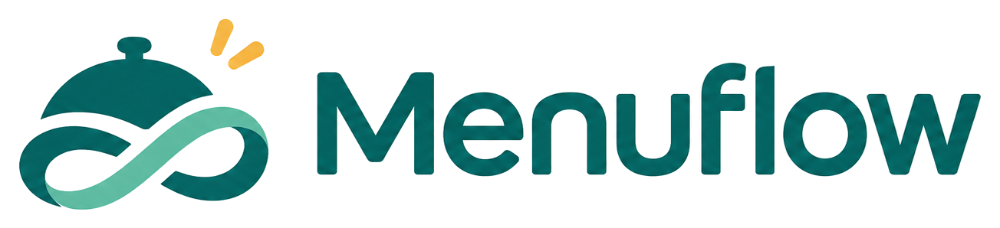
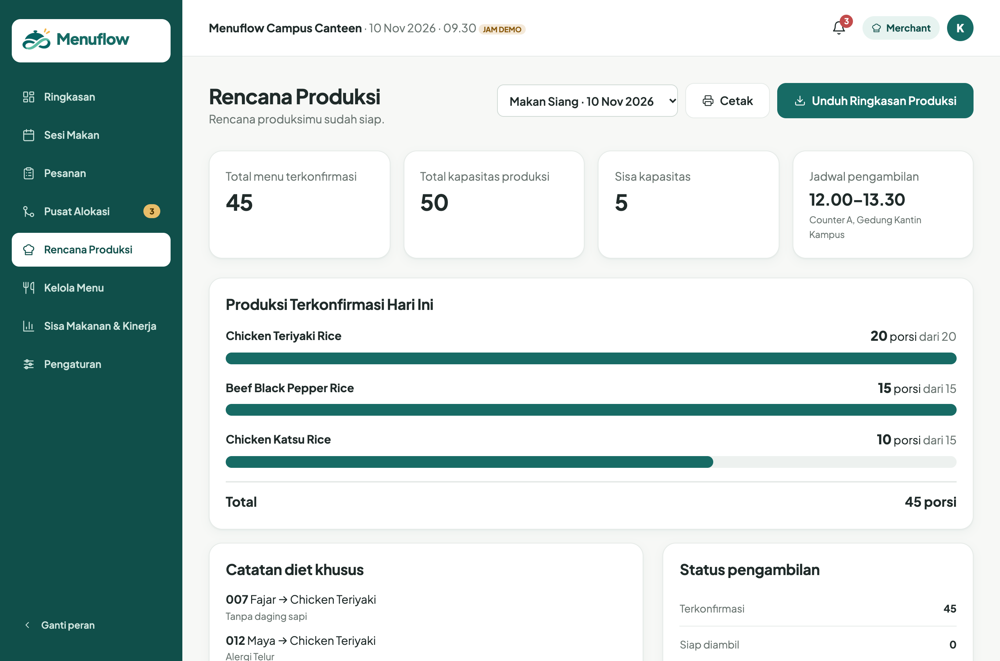
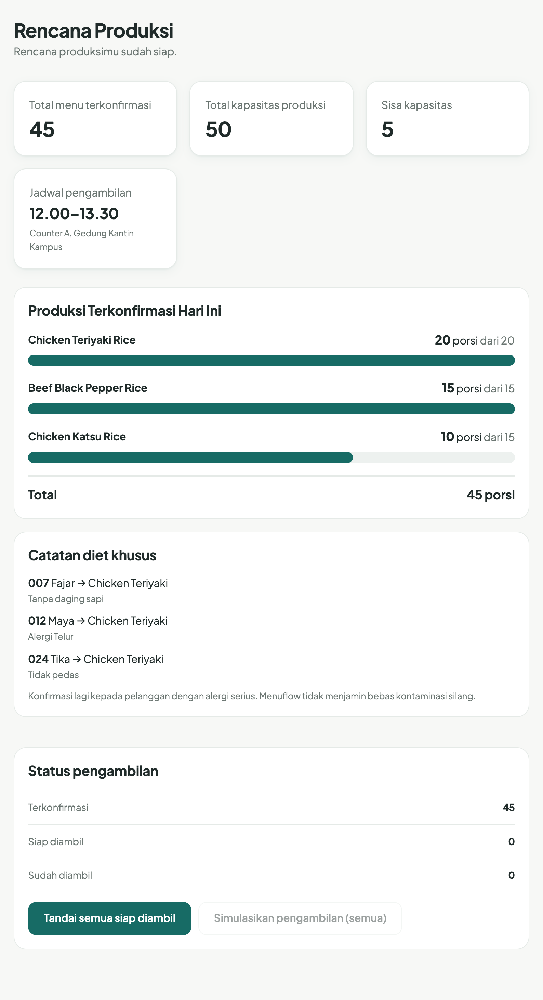

<div align="center">



### Better Choices. Smarter Preparation.

<p>Platform pemesanan makanan fleksibel dan koordinasi permintaan dapur untuk kantin, katering, dan penyedia makanan.</p>

<p>   </p>

</div>

---

## Fitur Cetak & Rencana Produksi

Setelah alokasi dikonfirmasi, merchant mendapat halaman **Rencana Produksi** yang siap dicetak atau diunduh untuk dapur.

<p align="center">
  
</p>

### Tombol Cetak

Klik **Cetak** untuk membuka dialog cetak browser. Stylesheet khusus cetak menyembunyikan sidebar, bilah atas, tombol, dan pemilih sesi, sehingga hasil cetak hanya berisi isi rencana: kartu ringkasan, produksi per menu, catatan diet khusus, dan status pengambilan.

<p align="center">
  
</p>

### Unduh Ringkasan Produksi

Tombol **Unduh Ringkasan Produksi** menghasilkan berkas teks `menuflow-production-summary.txt` berisi nama sesi, jadwal dan lokasi pengambilan, porsi per menu, total, serta catatan alergi dan diet tiap pesanan. Cocok untuk ditempel ke chat dapur atau dicetak dari aplikasi lain.

### Isi yang dicetak

| Bagian | Keterangan |
| --- | --- |
| Total menu terkonfirmasi | Jumlah porsi yang sudah dialokasikan |
| Kapasitas & sisa | Total kapasitas produksi dan sisanya |
| Jadwal pengambilan | Jam dan lokasi pengambilan |
| Produksi per menu | Porsi terkonfirmasi dibanding kapasitas tiap menu |
| Catatan diet khusus | Alergi, pantangan, dan catatan per pesanan |
| Status pengambilan | Terkonfirmasi, siap diambil, sudah diambil |

## Menjalankan

Tanpa dependensi, cukup Node.js.

```bash
npm run dev     # http://localhost:5173/  (aplikasi: /app/)
npm test        # unit test logika alokasi
```

Untuk melihat fitur cetak: buka `/app/`, masuk sebagai **Merchant**, buka **Pusat Alokasi**, buat pratinjau, tinjau, publikasikan, lalu Anda diarahkan ke **Rencana Produksi**.

## Catatan

Ini prototipe dengan data demo yang tersimpan di `localStorage` browser. Menuflow tidak menjamin makanan bebas kontaminasi silang; informasi alergen berasal dari pihak kantin.

## Lisensi

MIT. Hak cipta © 2026 Vassel Goleyu.
